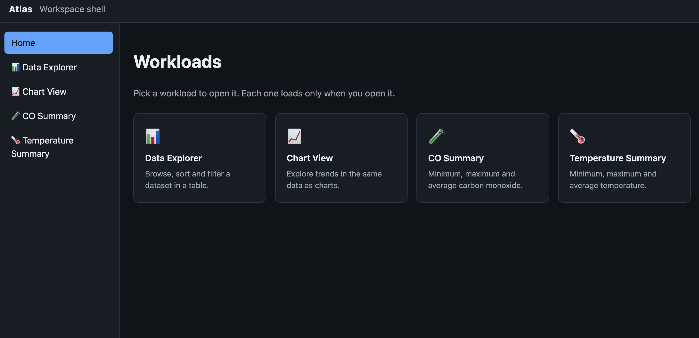

# Atlas: a pluggable data workspace shell

A small browser app, written in TypeScript and React, where a shell hosts "workloads" that plug into it. It explores about 7,000 hourly air quality readings with a sortable, filterable table and charts.

**Live demo:** https://pubaaaali.github.io/atlas-shell/



## What it demonstrates

- **A typed plugin contract.** Each workload describes itself (`id`, `title`, `icon`, a lazy `load()`), and the shell renders tiles, navigation and routes from the registry. The registry rejects duplicate ids and caches each lazy component so its identity stays stable between renders.
- **Code splitting.** A workload's code downloads only when it is opened.
- **Manifest-loaded plugins.** `public/plugins/manifest.json` declares extra workloads. The manifest is treated as untrusted input: every entry is validated, bad entries are skipped with a console warning, a plugin can never replace an existing workload, and a broken manifest never stops the app from starting. Manifest plugins are declarative (summary widgets), so no remote code runs.
- **Table performance.** The Data Explorer can virtualise its rows (TanStack Virtual) and shows how many rows are in the DOM and how long the last update took to paint.
- **Accessibility.** Skip link, visible focus styles, labelled controls, `aria-sort` on sortable headers, `aria-rowcount` and `aria-rowindex` on the virtualised table, and a text summary under each chart.
- **Engineering hygiene.** Strict TypeScript, ESLint, 43 tests (Vitest and React Testing Library), and CI on every pull request.

## Measured performance

Sorting the 6,941-row table by CO, 10 clicks per mode, production build (`npm run build && npm run preview`), Chrome 158 on MacBook Air (Apple M1), 20 November 2026:

| | Rows in the DOM | Median click-to-paint | Range |
|---|---|---|---|
| Virtualisation off | 6,941 | 568 ms | 534 to 713 ms |
| Virtualisation on | 26 | 15 ms | 12 to 17 ms |

With virtualisation on, the number of rows in the DOM depends on the window height (26 at the size used).

Click-to-paint is measured with two `requestAnimationFrame` calls, so about one to two frames of browser scheduling are included in both numbers. This is a small, single-machine measurement, not a benchmark.

## Run it

```bash
npm install
npm run dev      # http://localhost:5173/atlas-shell/
npm test
npm run build && npm run preview
```

## Data

Hourly readings from the UCI Machine Learning Repository's Air Quality dataset (De Vito et al., 2008). Values of -200 mark missing readings and are treated as missing, not as numbers. The app uses a cleaned copy of 6,941 rows, produced from the roughly 9,300 raw hourly readings in a university data visualisation project. Check the dataset page for its current licence terms and keep the attribution.

## Project layout

- `src/shell`: layout, routing, tile home screen, workload registry
- `src/workloads`: Data Explorer and Chart View
- `src/plugins`: manifest validation and manifest-loaded workloads
- `src/data`: CSV parsing, sorting and filtering, aggregation
- `src/charts`: SVG chart component

## Known limitations

- Manifest plugins are limited to declarative summary widgets by design.
- Charts are hand-drawn SVG and have no tooltips or zoom.
- Performance numbers come from one machine and one browser.